<h1 data-importer="text" align="center">Olá 👋! 👨🏾‍💻 Meu nome é Luan Victor.</h1>

###

Meu nome é Luan Victor de Faria Brito, tenho 23 anos, e sou estudante de Ciência da Computação na Faculdade Anhanguera, atualmente cursando o 6º semestre, com conclusão prevista para dezembro de 2027. Moro em Belo Horizonte, MG, e desde pequeno sempre fui apaixonado por tecnologia, especialmente por jogos, sites, sistemas operacionais, aplicativos e dispositivos. Essa curiosidade sobre como os softwares são feitos me inspirou a seguir carreira na área.  Estou em busca da minha primeira oportunidade de estágio, onde poderei adquirir experiência prática no mercado, trabalhar com projetos reais e aprimorar minhas habilidades como programador. Tenho planos de focar em diferentes áreas de desenvolvimento ao longo de cada ano da minha formação. Em 2025, meu principal objetivo é me especializar como desenvolvedor Full Stack, com ênfase no desenvolvimento web.

###

  
  

###

  
  
  
  
  
  
  
  
  
  
  
  
  

###

###

  
  
  

###

 

###
